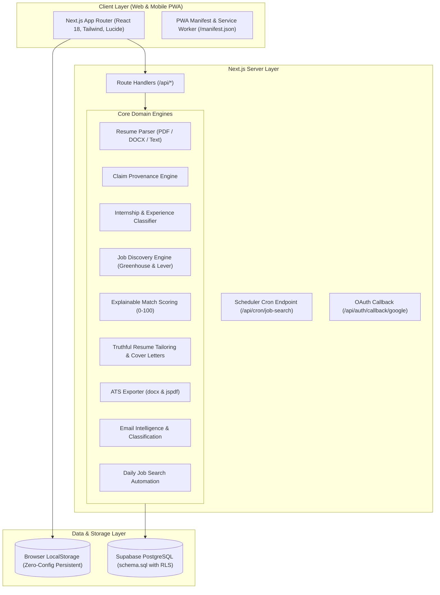

# 🚀 JobPilot AI — Intelligent Job Search & Application Platform

> **Candidate Integrity First:** A truthful, full-stack AI platform for discovering, ranking, tailoring, and tracking job applications across the entire hiring lifecycle without exaggerating or falsifying candidate credentials.

[](https://nextjs.org/)
[](https://www.typescriptlang.org/)
[](https://tailwindcss.com/)
[](https://vitest.dev/)
[](https://opensource.org/licenses/MIT)

---

## 🌟 Key Highlights & Architectural Principles

1. **Truthfulness & Candidate Integrity (Non-Negotiable)**
   - The master resume is immutable and cryptographically verified via SHA-256 checksums.
   - Built-in **Claim Provenance Engine** inspects every bullet in tailored resumes and cover letters.
   - Ungrounded metrics (e.g. invented percentages or revenue claims) and hallucinated technical skills are automatically detected and flagged.
   - Skill gaps are reported transparently in a dedicated **Skills Gap Report** rather than secretly injected into the resume.

2. **Explicit Experience & Internship Classification**
   - Preserves original employment categories; never mislabels an internship as a full-time position.
   - Excludes academic coursework and capstone projects from professional employment calculations.
   - Computes two distinct, auditable figures: **Total Relevant Experience** vs. **Full-Time Professional Experience**.
   - Handles overlapping positions chronologically without double-counting duration.

3. **Responsible Job Discovery**
   - Connects directly to official, permitted public job board endpoints (**Greenhouse Public Boards API** and **Lever Public Postings API**).
   - Universal **CSV Import Adapter** for manual spreadsheets and custom company feeds.
   - Deduplication by external ID and normalized company/title/location keys.

4. **Zero-Mandatory-Cost Architecture**
   - 100% operational on free-tier services.
   - Deterministic rule-based engines for resume tailoring, match scoring, and email classification provide complete offline functionality without requiring paid AI API keys.
   - Optional integration with Google Gemini Flash (AI Studio free tier).
   - Works immediately out-of-the-box with persistent browser `localStorage`, with full PostgreSQL / Supabase schema parity provided in `schema.sql`.

---

## 📐 System Architecture



---

## 🛠️ Technology Stack

| Layer | Technology | Rationale & Free-Tier Suitability |
|---|---|---|
| **Framework** | Next.js 14 (App Router) | High performance React SSR/SSG, serverless API routes, zero hosting cost on Vercel |
| **Language** | TypeScript 5.6 (Strict Mode) | End-to-end type safety, reliable refactoring |
| **Styling** | Tailwind CSS + Lucide Icons | Responsive, mobile-first design, dark-mode SaaS design system |
| **Document Generation** | `docx` & `jspdf` | Real, selectable text ATS-friendly PDF and Word document generation |
| **Document Parsing** | `mammoth` & custom parser | Local parsing of uploaded DOCX and plain text resumes |
| **AI Integration** | `@google/generative-ai` | Optional free-tier Google Gemini 1.5/2.0 Flash with deterministic fallback |
| **Testing** | Vitest 2.1 | Fast in-memory unit and integration test runner |
| **Database** | PostgreSQL / Supabase | Schema with Row Level Security (RLS) included in `src/lib/db/schema.sql` |

---

## 🚀 Quickstart & Local Development

### Prerequisites
- Node.js 18+ (tested on Node v20 / v24)
- npm 9+

### 1. Clone & Install
```bash
git clone https://github.com/your-username/jobpilot-ai.git
cd jobpilot-ai
npm install
```

### 2. Environment Configuration (Optional)
The application works immediately out-of-the-box with pre-seeded data and deterministic offline engines. If you wish to connect external services:

```bash
cp .env.example .env.local
```

Edit `.env.local`:
```env
# Optional: Google Gemini Flash Free Tier (https://aistudio.google.com)
GEMINI_API_KEY="your-gemini-api-key"

# Optional: Supabase PostgreSQL (https://supabase.com)
NEXT_PUBLIC_SUPABASE_URL="https://your-project.supabase.co"
NEXT_PUBLIC_SUPABASE_ANON_KEY="your-anon-key"

# Cron Secret for automated scheduled search endpoint
CRON_SECRET="your-secure-cron-secret"
```

### 3. Run the Development Server
```bash
npm run dev
```

Open [http://localhost:3000](http://localhost:3000) in your browser.

---

## 🧪 Testing & Quality Assurance

JobPilot AI includes comprehensive unit and integration test suites covering all core business logic and domain engines:

```bash
npm test
```

### Test Coverage Highlights:
- **`tests/experience-classifier.test.ts`**: Verifies internship preservation, academic project exclusion, and non-overlapping month calculations.
- **`tests/claim-provenance.test.ts`**: Verifies detection of ungrounded metrics and hallucinated skills.
- **`tests/relevance-scorer.test.ts`**: Verifies explainable 0–100 weighted scoring and critical gap detection.
- **`tests/discovery-engine.test.ts`**: Verifies job deduplication and source normalization.
- **`tests/tailor-service.test.ts`**: Verifies bullet enhancement and skill gap reporting.
- **`tests/email-service.test.ts`**: Verifies classification of interview invites, offers, and confirmations.

To run a production build verification:
```bash
npm run build
```

---

## 📁 Project Directory Structure

```
jobpilot-ai/
├── public/
│   ├── icon.svg                     # PWA icon
│   └── manifest.json                # PWA manifest
├── src/
│   ├── app/
│   │   ├── api/
│   │   │   ├── auth/callback/google/route.ts  # Gmail OAuth callback
│   │   │   └── cron/job-search/route.ts       # Secured scheduled search endpoint
│   │   ├── app/
│   │   │   ├── applications/        # Kanban and tabular application tracker
│   │   │   ├── applications/[id]/   # Workspace: Tailor, Cover Letter, Notes
│   │   │   ├── automation/          # Scheduled daily search configuration
│   │   │   ├── dashboard/           # Real KPI analytics and funnel charts
│   │   │   ├── inbox/               # Email response categorization & triage
│   │   │   ├── jobs/                # Multi-source job discovery & CSV import
│   │   │   ├── jobs/[id]/           # Job details & explainable match score
│   │   │   ├── notifications/       # In-app notification center
│   │   │   ├── profile/             # Master resume & experience classifier
│   │   │   └── settings/            # AI provider config & data export/reset
│   │   ├── login/                   # Sign in page (Demo / Guest mode)
│   │   ├── onboarding/              # 3-step candidate onboarding wizard
│   │   ├── signup/                  # Sign up page
│   │   ├── globals.css              # Tailwind CSS styles
│   │   ├── layout.tsx               # Root layout with AppProvider
│   │   └── page.tsx                 # SaaS landing page
│   ├── components/
│   │   ├── applications/            # PipelineKanban board
│   │   ├── jobs/                    # JobCard with match badges
│   │   ├── layout/                  # Navbar with mobile drawer
│   │   ├── tailoring/               # SideBySideTailor workspace
│   │   └── ui/                      # Button, Badge, Card, Modal
│   ├── context/
│   │   └── app-context.tsx          # Client-side persistent state layer
│   ├── lib/
│   │   ├── classification/          # Explicit experience & internship engine
│   │   ├── db/                      # PostgreSQL schema.sql with RLS policies
│   │   ├── discovery/               # Greenhouse, Lever, and CSV adapters
│   │   ├── email/                   # Email classification & mock dataset
│   │   ├── export/                  # Real DOCX and ATS PDF exporters
│   │   ├── integrity/               # Candidate claim provenance validator
│   │   ├── parser/                  # PDF/DOCX/Text resume parser
│   │   ├── scheduler/               # Idempotent cron runner
│   │   ├── scoring/                 # 0-100 explainable match scorer
│   │   ├── store/                   # Realistic seed dataset
│   │   └── tailoring/               # Truthful resume tailor & cover letters
│   └── types/
│       └── index.ts                 # Full TypeScript domain models
├── tests/                           # Vitest test suites (100% passing)
├── .env.example                     # Environment template
├── package.json
├── tailwind.config.ts
├── tsconfig.json
└── vitest.config.ts
```

---

## 🔒 Security & Candidate Integrity Tenets

- **No Hallucinated Claims:** Generated resumes and cover letters never invent credentials or metrics. Every proposed bullet must be grounded in an immutable master resume fact ID.
- **Row-Level Security (RLS):** When connected to Supabase, all database tables enforce user-level data isolation via `auth.uid() = user_id`.
- **Read-Only Email Access:** Gmail OAuth scopes are restricted to read-only metadata and message snippets; the application never sends emails or communicates externally without explicit human authorization.
- **Assisted Application Workflow:** JobPilot AI prepares all application documents, but final submissions require human-in-the-loop review to comply with terms of service.

---

## 🚢 Deployment Guide (Vercel + Supabase)

### 1. Deploy Frontend to Vercel
1. Push your repository to GitHub.
2. Import the repository in [Vercel](https://vercel.com).
3. Set the Root Directory to `jobpilot-ai`.
4. Deploy!

### 2. Optional: Connect Supabase PostgreSQL
1. Create a free project at [Supabase](https://supabase.com).
2. In the Supabase SQL Editor, paste and execute [`src/lib/db/schema.sql`](src/lib/db/schema.sql).
3. Copy your Project URL and Anon Key into your Vercel Environment Variables:
   - `NEXT_PUBLIC_SUPABASE_URL`
   - `NEXT_PUBLIC_SUPABASE_ANON_KEY`

### 3. Set Up Daily Scheduled Job Searches
- In Vercel, navigate to **Settings** > **Cron Jobs**.
- Add a cron schedule targeting `/api/cron/job-search` daily at 09:00 UTC.
- Add `CRON_SECRET` to your environment variables and pass it in the authorization header.

---

## 📄 License

This project is open-source and licensed under the [MIT License](LICENSE).
